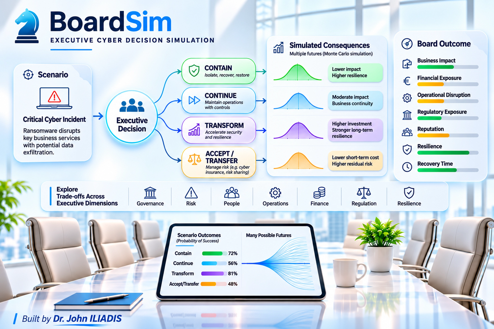

# BoardSim — implementation workspace

**Executive Decision-Making Under Pressure.** BoardSim is a board-level executive
cybersecurity decision simulator with a deterministic, server-authoritative engine.



## About

BoardSim demonstrates the capability I consider most important at executive level:
turning cybersecurity analysis into decisions. I designed it as a board-level
simulation in which leaders must weigh risk, business impact, constraints and
competing priorities rather than simply review another dashboard. For an employer,
BoardSim provides tangible evidence of strategic thinking, risk appetite awareness,
executive judgement and the ability to model how cybersecurity choices affect the
wider organisation.

## So what?

**The problem, in one sentence:** dashboards tell executives what happened, but
nothing prepares them for the moment they must *decide* — under time pressure,
with incomplete information, with regulators and customers already waiting — and
that moment decides how an incident ends.

**A few-seconds demo:** [watch BoardSim run on YouTube](https://youtu.be/dXDKiQYx4WU).

### What problem this solves and for whom

BoardSim turns a cyber crisis into a repeatable, scored board exercise: a real
decision under pressure, a deterministic score from a published rule set, a
rule-by-rule trace that shows *why*, and a shareable read-only result.

- **Boards and executives** — practise the decision itself rather than another
  briefing, and see the consequences of each option before the real crisis.
- **CISOs and security leaders** — evidence executive-level judgement to a board
  or an employer with results that are reproducible rather than anecdotal.
- **Hiring panels and educators** — observe decision quality against a published,
  inspectable standard instead of an unstructured interview or a lecture.

There is no account, no cost and no dashboard to read: the product is the
decision and its trace.

## Methodology

**Server-authoritative and deterministic for the run's pinned release.** The browser
never computes a score, never receives hidden score deltas and cannot influence
the number. The server resolves the policy, content, regulatory and difficulty
identities pinned to the run, with no model or randomness. Retained historical
policy/content versions are loaded and hash-checked; if any exact required artifact
is unavailable, interpretation fails with `RUN_RELEASE_UNAVAILABLE` rather than
silently mixing releases.

**The exercise.** Fourteen board-level scenarios, each with three decision stages
and three options per stage, followed by a board pack. A run records every
decision behind an idempotency key, then the board brief: seven substantiated fields in the `leadership` view
(situation, impact, uncertainty, action, funding, residual risk, board ask) or
four in the `executive` view. `board_crisis` is a declared refusal: the API
answers 422 rather than score an unvalidated configuration.

**The score.** Ten weighted dimensions each start neutral at 70. The decision
rules that fire add or subtract their authored deltas, the risk-appetite setting
adds its modifier to risk judgment only, and each dimension is clipped to
0–100:

```
dimension[d] = clamp(70 + Σ rule_deltas[d] + appetite_modifier[d], 0, 100)
numerator    = Σ (weight[d] × dimension[d])
score        = floor((numerator + 50) / 100)
```

The result is an integer from 0 to 100 across five published bands — not a
percentage of correct answers. Every delta is visible in the result page's rule
trace, together with the arithmetic that produced the final number.

**The rules.** 47 authored decision rules carry fixed dimensional deltas and a
NIST CSF 2.0 function each, so the trace reads as an operating-model view as
well as a score. The seven board-pack fields (DR-041..DR-047) score only when
the chosen option substantiates them; a declined field fires nothing and is
listed as declined.

**Regulation is assessed separately.** A second engine evaluates 28 regulatory
instruments from the published register (REG-*) over authored facts, using
three-valued Kleene logic and a clock engine, and reports applicability, trigger
and reporting duties — never from the option picked and never as a score input.
Where the facts do not establish scope, the status is "pending classification",
not a guess, and instruments that require counsel remain marked as such.

**Reproducibility and integrity.** Every run pins the scoring policy, regulatory
bundle, scenario content and difficulty projection. Decision events snapshot the
authored option label and non-scoring effects. The integrity check recomputes every
persisted event hash, state-transition continuity, the hashed run row, board
selections, dimensions and final score through the matching release. It is a
consistency proof, not a digital signature against a privileged attacker able to
rewrite data and hashes coherently. "What would change it?" substitutes an
alternative choice through the same pinned release. Portfolios aggregate 3–5 runs
per segment keyed by exact policy, content and difficulty-view hashes plus difficulty.

**Calibrated against itself, and only against itself.** The full option space —
2,268 enumerated runs — reproduces the published goldens exactly; the 1.1.0
calibration reduced positional bias to −35% and keeps all five bands reachable.
The weights and deltas remain authored judgement: the score measures how a
decision compares with the published BoardSim policy — it is not a psychometric,
hiring or compliance instrument, and every result page says so.

**Everything is inspectable.** The specification is 29 SHA-256-pinned documents;
content is authored overlays compiled into hashed, immutable bundles; the live
methodology (formula, weights, appetite modifiers, bands) is served at
`/v1/methodology` and rendered at `#/methodology`, and every rule, instrument
and dimension is defined once in `/v1/glossary`.

The 30 Markdown files in `requirements/`, `scenarios/` and `engine/` are the
specification and are **SHA-256 pinned and immutable** (`SHA256_MANIFEST.md`
lists every one, including `10_OPEN_SOURCE.md`, the repository-hygiene
requirement). Nothing here edits them; every addition is either code or a
versioned overlay.

Line endings are pinned too: `.gitattributes` normalises every text file to LF,
because a CRLF checkout on Windows would change the bytes and break verification
on a fresh clone.

## Current state

| Layer | Status |
|---|---|
| Pinned specification (29 files) | Verified, 29/29 hashes match |
| YAML allowlist parser | Done — parses all 14 scenarios, both policy blocks, flow collections |
| Content overlay layer (F-2 / F-1) | Done — current bundle `1.3.2`, historical releases retained, fail-closed |
| Regulatory evaluator, Kleene logic, clock engine | Done — 67 invariants green |
| Layer 2 facts | Done — all 14 scenarios, all five statuses exercised |
| **Scoring engine (Stage 2)** | **Done — both published goldens reproduce exactly** |
| **Board-pack rubric** | **Done — 7 fields, DR-041..DR-047 gated on substantiation** |
| **Enumeration (Stage 3)** | **Done — 2,268 runs reproduce min 58 / max 84 / mean 71.15** |
| **Calibration (current ruleset 1.3.2)** | **Done — includes the 1.1.0 rebalance; positional bias −35%, all five score labels reachable** |
| **Content v1.1.0 (option remaps)** | **Done — 2 mis-mappings corrected; dominance register published** |
| **Content 1.3.2 (current release)** | **Done — retains the 1.3.0 executive wording across all 14 scenarios; mappings, effects and scores unchanged; 28/42 dominant re-confirmed** |
| **Content 1.2.0 (dominance)** | **Done — 3 narrow gaps closed, 31→28 dominant; mean 70.78/70.44, all five bands reachable** |
| **API + MySQL store (Stage 4)** | **Done — 99 invariants green; MySQL adapter unverified on host** |
| **SPA (Stage 5)** | **Done — builds, serves same-origin, full run verified over HTTP** |
| **Difficulty views (F-5)** | **Done — leadership 7 fields, executive 4, board_crisis refused with 422** |
| **Enumeration baselines** | **Done — leadership and executive measured separately, never merged** |
| **Portfolio aggregation** | **Done — 3–5 run window, segmented by ruleset, content and difficulty** |
| **"What would change it?" (05)** | **Done — alternative substituted and replayed, identity-checked against the recorded score** |
| **Security headers + CSP** | **Done — one policy, Apache mirror, drift-tested** |
| **In-product glossary** | **Done — `/v1/glossary` derived from the pinned sources, drift-tested; 47 rules, 28 instruments, 10 dimensions** |
| **NIST CSF function per rule** | **Done — authored overlay, all 47 rules mapped, surfaced in the glossary** |
| **Methodology page** | **Done — `#/methodology` renders the live formula, weights, appetite modifiers and bands** |
| **Rate limiting** | **Done — per-client fixed window on run creation, decisions, shares and reads; 429 with `Retry-After`** |
| **Accessibility measurement** | **Done — contrast and target sizes computed and asserted, not asserted** |
| **Static metadata and discovery** | **Done — author/canonical/Open Graph/JSON-LD `WebApplication` in the served HTML, plus `robots.txt`, stamped `sitemap.xml` and `llms.txt` at the origin root** |
| **Application imagery** | **Done — SVG knight mark in header and favicon; the boardsim2 explainer as the homepage hero and README banner; a 1200×630 letterboxed social card as `og:image`/`twitter:image`/JSON-LD `image` — all asserted by `bin/verify-meta.php`** |
| **Acceptance traceability (07)** | **Done — 41 requirements mapped, gaps named: `docs/acceptance-matrix.md`** |
| **Public demo (06)** | **Done — `DEMO-001`, unscored and unpersisted; the scorer is never constructed** |
| **Board room (06)** | **Done — 3 challenge cards, advisory 5-minute timer, no 8th field** |
| **Erasure (06)** | **Done — model A: physical delete, self-service, irreversible; consent v3 drafted** |
| **Profiles + share links (06)** | **Done — 7-day hashed token, revocation, read-only shared view, days-left counter** |
| Deployment target | PHP 8.2+ / MySQL on `boardsim.iliadis.net` |

## Running the app locally (no MySQL needed)

```bash
cd web && npm install && npm run build && cd ..
php bin/dev.php                  # http://127.0.0.1:8100
```

`bin/dev.php` starts PHP's built-in server with the router script and
`BOARDSIM_DEV=1` already set, because those are the two arguments it is easy to
forget by hand. The equivalent manual command is:

```bash
BOARDSIM_DEV=1 php -S 127.0.0.1:8100 -t public web/dev-router.php
```

`BOARDSIM_DEV=1` swaps the MySQL store for `FileRunStore` (a JSON file under
`var/`) and reports `mode=dev` on `/v1/health`. It exists only so the front end
can be developed without a database; never enable it on a public host.

For front-end hot reload, run `npm run dev` in `web/` (Vite proxies `/v1` to the
PHP server on port 8100, so start that server first).

The router argument (`web/dev-router.php`) is mandatory: PHP's built-in server
ignores `.htaccess`, so without it every `/v1/...` request is answered by PHP's
own HTML 404 page. The SPA still renders, but the footer reads "Scoring policy
unavailable" and the API calls report `NON_JSON_RESPONSE`. Similarly, opening the
built `public/app/index.html` through a plain static file server (or through a
server rooted at `public/app`) serves the SPA's HTML for `/v1/...` and fails the
same way. The interface and the API must be served from one origin by PHP.

Three artefact identities are recorded per run:

| Pin | 1.0.0 | Latest | Contents |
|---|---|---|---|
| Regulatory bundle | `4124f451…` | unchanged | instruments, predicates, facts, guards |
| Scoring policy | `dd533b45…` | `b2135b59…` | rules, weights, appetite, board rubric, ladder |
| Scenario content | pinned option graph | option remaps | scenario versions + mapping corrections |

A run stores all release identities, including the difficulty-view version/hash.
`RunService` selects a per-run context: retained historical policy and content are
loaded by version and verified by hash, while regulatory and difficulty artifacts
must match an available exact hash. Missing or mismatched artifacts produce
`RUN_RELEASE_UNAVAILABLE`; they are never replaced with the current release.

Calibration evidence lives in [`docs/calibration-findings.md`](docs/calibration-findings.md)
and the required re-score report in
[`docs/rescore-report-1.0.0-to-1.1.0.md`](docs/rescore-report-1.0.0-to-1.1.0.md).

Per-difficulty enumeration baselines and the portfolio-aggregation rules are in
[`docs/difficulty-baselines.md`](docs/difficulty-baselines.md). The short version:
executive drops three board rules, so its pre-rounding numerator is exactly 66
hundredths lower on the same path — which the integer clamp usually absorbs, so the
two views must never be merged into one profile.

## Commands

```bash
php bin/dev.php                  # local server with router + dev store
php bin/build-deploy.php --version=1.3.2   # two upload folders + zips (host needs no shell)
php bin/migrate.php --check      # schema + pinned-bundle reconciliation (run from cron)
php bin/verify-hygiene.php       # no host paths committed
php bin/verify-manifest.php      # re-hash the 29 pinned files
php bin/verify-lint.php          # syntax-check every PHP file, including the MySQL adapters
php tools/smoke-yaml.php         # parse every pinned scenario YAML block
php tools/smoke-policy.php       # parse CONFIG.md + 03_DECISION_RULES.md
php bin/content-build.php        # compile and write the regulatory bundle
php bin/verify-regulatory.php    # F-2 / F-1 invariants (67)
php bin/verify-scoring.php       # Stage 2 arithmetic + guard chain (51)
php bin/enumerate.php            # Stage 3: 2,268 runs + determinism replay
php bin/enumerate.php --difficulty=executive   # its own baseline, never merged
php bin/enumerate.php --ruleset=1.0.0   # pin the historical baseline
php bin/rescore.php 1.0.0        # re-score report: old vs new policy
php tools/dominance-report.php   # per-stage dominance with option labels
php bin/verify-api.php           # lifecycle, idempotency, chain, profiles
php bin/verify-glossary.php      # glossary covers every dimension, rule, instrument, setting
php bin/verify-ratelimit.php     # rate-limit decisions per client, action and window
php bin/verify-meta.php          # metadata + discovery files; --require-build insists public/app/ exists
php bin/verify-contrast.php      # WCAG contrast ratios and target sizes, measured
php bin/verify-http.php          # HTTP contract for the SPA
php bin/verify-deploy.php --base=https://boardsim.iliadis.net   # a live origin, not the artefact
php bin/verify-refs.php          # resolve every official source URL (host only)
php bin/purge.php --dry-run      # retention: show the 7-day cutoff, delete nothing
php bin/purge.php                # retention: physically delete runs past the ceiling
php bin/governance-report.php    # regenerate the per-REG-xxx sign-off register
```

### Authoring aids

Not part of the check suite and never run by the application: they read the
pinned corpus and print, so a content change can be reasoned about before it is
made.

```bash
php tools/rule-usage.php                 # which stage-option position uses which rule
php tools/narrow-stage.php BS-002 S1     # which third rule would close a dominance gap
php tools/dump-scenario.php [BS-00X]     # decision-relevant content of each scenario
php tools/dump-org.php                   # organisation profile per scenario
```

## Deploying

Two supported shapes, same server:

- **No shell on the host** (cPanel, FTP, phpMyAdmin, cron): follow
  [`docs/deploy-cpanel.md`](docs/deploy-cpanel.md). `php bin/build-deploy.php`
  produces the two folders to upload — the document root (`.htaccess`, `app/`,
  `api/`) and the backend outside it — plus `install.sql`, `cron.txt` and
  `verify.txt`. Nothing runs on the host except the three cron jobs, and
  `GET /v1/health` reports the release, the schema and the seeded bundles.
- **Shell on the host**: [`DEPLOYMENT.md`](DEPLOYMENT.md) — document root,
  database setup, least-privilege grants, where credentials live, cron.

Host-specific paths belong in `deploy/host.config.php` (gitignored); the committed
`deploy/host.config.example.php` carries placeholders and the build refuses to run
until they are replaced. `php bin/verify-hygiene.php` fails if a real host path
ever reaches the repository.

## Applying the schema

```sql
SOURCE migrations/001_init.sql;
SOURCE migrations/002_events.sql;
SOURCE migrations/003_share_tokens.sql;
SOURCE migrations/004_rate_limits.sql;
SOURCE migrations/005_release_integrity.sql;
```

Then follow `migrations/README.md` for the least-privilege grants and the optional
no-update event trigger. `GET /v1/health` reports which integrity controls are active,
so the methodology page never claims more than the deployment provides.

## License

BoardSim is Apache-2.0 — see [`LICENSE`](LICENSE). The PHP engine has no
third-party runtime dependencies; the web build embeds React (MIT) and uses
MIT/ISC/BSD/CC/Apache-2.0 build tooling. Attributions and the reasoning for the
absence of a `NOTICE` file are in [`THIRD-PARTY-NOTICES.md`](THIRD-PARTY-NOTICES.md).

## Repository hygiene

This repository is public, so three files carry real weight:

- **`.gitignore`** excludes credentials (`.env*`, `*.pem`, `*.key`, `*.p12`, SSH
  keys, `.npmrc`, `config.local.php`, `deploy/host.config.php`), database files
  and dumps, archives, `vendor/`, `node_modules/`, build output, coverage, agent
  and editor state, local notes (`*.local.*`) and Office exports. `package-lock.json`
  and `content/bundles/` are deliberately tracked. Nothing in the repository
  needs a secret at build time.
- **`.gitattributes`** normalises every text file to LF. This is not cosmetic:
  the specification is SHA-256 pinned, and a CRLF checkout on Windows would
  change the bytes and make `bin/verify-manifest.php` fail on a fresh clone.
- **`bin/verify-hygiene.php`** enforces both lists in the other direction: it
  fails if anything tracked matches the never-publish set (build output, host
  config, archives, credentials, editor state) and fails if a file a fresh clone
  needs — `.env.example`, `deploy/host.config.example.php`, the lockfile,
  `public/robots.txt`, `public/sitemap.xml`, `public/llms.txt`, the CI workflow —
  is **not** tracked. A publish is therefore checked, not trusted.

### Discovery and metadata

The SPA is client-rendered, so everything a crawler, a social-preview bot or a
language model needs is written into the served HTML by hand, not injected at
runtime: exact title, description, `author` meta and link, canonical URL,
Open Graph and Twitter tags, and a schema.org `WebApplication` graph. Three
static files sit at the origin root — `robots.txt`, `sitemap.xml` (lastmod
stamped by `bin/build-deploy.php`) and `llms.txt` (the llmstxt.org shape: what the
product is, its endpoints, and what it is not). `bin/verify-meta.php` asserts the
whole set in source, in the build output and in the routing rules;
`bin/verify-deploy.php` re-asserts it against the live origin.

`public/app/` is generated and gitignored, so the build-output half of
`verify-meta.php` is reported as **SKIP** on a clean checkout rather than failing —
a check must not depend on whether someone has run the front-end build. CI runs
it twice: once as-is for the source and discovery files, and once with
`--require-build` in the front-end job, after `npm run build`, where the absence of
the shell really is a failure.

Three deploy-time rules exist because the opposite of each one produced a silent
outage on this site:

- `/` is a directory. The rewrite maps the empty path to the shell *before* its
  real-file test, or Apache stops at `-d`, finds no `DirectoryIndex` and answers
  **403** to every crawler while the SPA still renders in a browser.
- A missing discovery file is a **404**, not the SPA shell with HTTP 200, so an
  incomplete upload announces itself.
- The build reads its own archives back and refuses to finish if `docroot.zip` is
  missing any of its six key files, then writes a release-named copy
  (`docroot-<version>.zip`); `bin/verify-deploy.php` compares the **served shell
  byte-for-byte** with the local build, because a release that changes only PHP and
  HTML keeps the same JS asset hash and would otherwise look deployed.

### The product image

One explainer image, `pics-source/boardsim2` (3072×2048), carries the product
story — a critical cyber incident scenario flowing into one executive decision,
with simulated consequences and a board outcome. It is kept in three formats
with identical content, and each use takes the format that suits it:

- **The homepage hero** — `web/public/boardsim-hero.webp`, the webp served at
  `/app/boardsim-hero.webp` and declared 600×400 (the exact 3:2 of the source),
  so the space is reserved before it loads. It replaced the SVG lockup in the
  hero; the lockup file stays as a brand asset.
- **The README banner** — the same webp, referenced at the top of this file.
- **The social card** — `web/public/boardsim-social.jpg`, a 1200×630 letterboxed
  derivative of the same source (the 3:2 original carries the logo at the top
  and the attribution at the bottom, and cropping would cut one of them). It is
  the `og:image`, the `twitter:image` and the JSON-LD `image`: scrapers want a
  JPEG, not a webp.
- **The GitHub social preview** — set by hand in *Settings → General → Social
  preview*: upload `web/public/boardsim-social.jpg` (GitHub accepts up to 1 MB;
  this derivative is 170 KB).

The identity marks stay SVG in `web/public/`: `boardsim-mark.svg` at 42 px in
the header, `favicon.svg` inset to survive 16 px, and the retired lockup
`boardsim-logo.svg` kept as the brand asset. The header's wordmark stays **real
text**, so the mark next to it is `alt=""` and a screen reader reads the name
once.

`bin/verify-meta.php` asserts the SVG files parse, that the mark and the favicon
are the same drawing, that the header and the hero reference the right images
with declared sizes, and that the JSON-LD `logo`/`image` URLs match what is
served.

### Licence

**Apache License 2.0** — see [`LICENSE`](LICENSE). Copyright 2026 Dr. John ILIADIS.

Note that the licence covers the code and the authored overlays. The regulatory
material referenced in `requirements/04_REGULATORY_REGISTER.md` and the pinned
scenario documents remain subject to their own sources; nothing here re-licenses
third-party legal text.

No runtime dependencies: `src/bootstrap.php` is a zero-dependency PSR-4
autoloader, because the production host offers PHP and MySQL only. Node is a
dev-time tool for the front-end build, never a runtime requirement.

## Architecture

```
requirements/ scenarios/ engine/   PINNED specification (never edited)
content/overlays/                  authored layer, versioned
  predicate_vocabulary.yaml        Layer 0  closed predicate vocabulary
  regulatory_instruments.yaml      Layer 1  28 REG-* anchors, defined once
  scenario_regulatory_facts.yaml   Layer 2  REGULATORY_ASSERTION facts
  rule_guards.yaml                 Layer 3  DR-027 guard bindings
  README.md                        divergence record and legal posture notes
content/bundles/                   compiled, hashed, immutable artefacts
src/Content/                       YAML parser, loader, canonical JSON
src/Domain/Regulation/             TriBool, predicates, clocks, evaluator, guards
bin/                               CLI entry points
tools/                             developer checks
```

### Why the engine is PHP

`01_ARCHITECTURE.md` requires the server to own scoring. The host runs PHP and
MySQL, so the engine is implemented once in PHP rather than duplicated in
TypeScript. The SPA is a pure renderer that never computes a score and never
receives score deltas.
